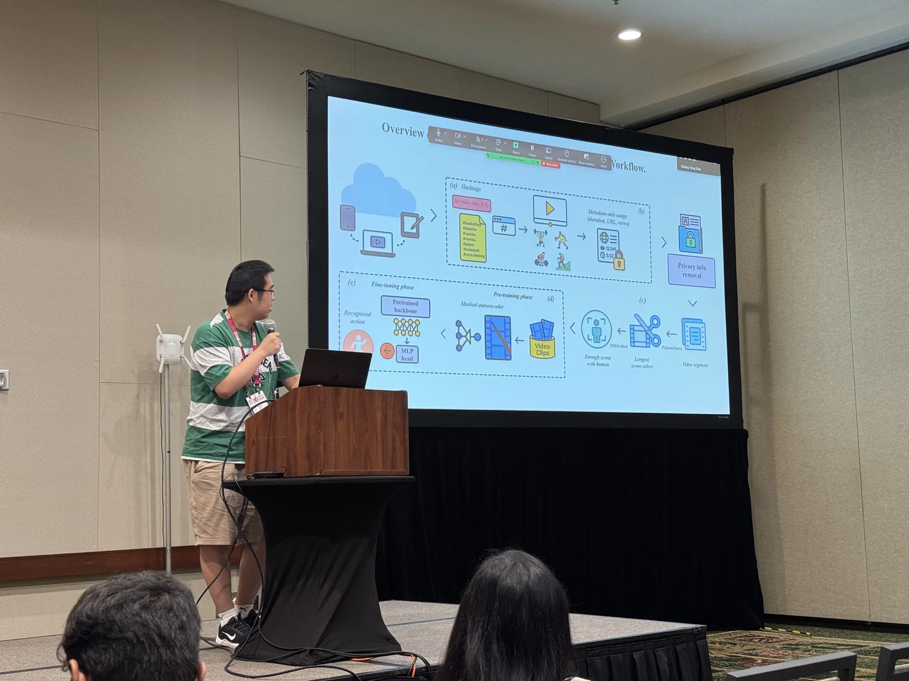

# News

## 2026-11-12 | CIRP and UH Mānoa at CoRL in Austin
The Conference on Robot Learning (CoRL) selected [3PTv2](https://openreview.net/forum?id=WNZ4Dr57JS) for a main-conference poster. CIRP PhD student Agastya Kalra and his co-authors, including Huaijin Chen, study zero-shot 6D object pose estimation for robotic manipulation.

CoRL also accepted [Telescopes are Optomechanical Robots](https://openreview.net/forum?id=RS2INStAhX) by UH Mānoa’s Justin Fletcher as a main-conference poster. At the [UMI Arena workshop](https://umi-arena.airoa.io/accepted), Yosub Shin, Yuan Liu, and Igor Molybog presented a poster on head-camera glove tracking (P09) and a hands-on exhibit of the [YAM-UMI](https://github.com/YosubShin/yam-umi) device (D10).
---

## 2026-10-01 | Riki MacMillan receives the Bubba Cook Award at SAFET 2026 {#2026-10-01-riki-macmillan-safet-2026}
CIRP graduate researcher Riki MacMillan received the **Bubba Cook Award for Emerging Technology** at the 2026 Seafood and Fisheries Emerging Technologies (SAFET) Conference in Cebu, Philippines. In his September 9 talk, *Scalable Metric Measurement of Marine Life with Low-Cost Commodity Hardware*, he presented work on measuring marine life with affordable smartphone cameras. Huaijin Chen and UH Mānoa colleague Erik Franklin also joined the panel on emerging technologies.

[SAFET award announcement](https://www.safet.fish/bubba-cook-award-for-emerging-technology-2026/) · [Panel recording](https://www.youtube.com/watch?v=AjQOYXbQYXo) · [Huaijin Chen’s conference recap](https://www.linkedin.com/posts/huaijinchen_safet2026-marineconservation-fisheriesscience-activity-7515553296754069504-KUXt)
---

## 2026-07 | Thank you to USDA for supporting plant pathogen risk assessment ($154,517) {#2026-07-usda-aphis-supports-plant-pathogen-risk-assessment}
Huaijin Chen is co-PI on a $154,517 USDA APHIS project to develop a machine learning tool that helps assess risks from plant pathogens.
---

## 2026-06-04 | Huaijin Chen gives a keynote at the CVPR 2026 UG2+ Workshop
Huaijin Chen presented “Do AI Agents Understand Computational Imaging?” at the [8th UG2+ Workshop and Challenge](https://cvpr2026ug2challenge.github.io/program24.html) in Denver.

---

## 2026-06 | Thank you to the Minderoo Foundation for supporting AI-based fish measurement ($153,311) {#2026-06-minderoo-foundation-supports-ai-based-fish-measurement}
The Minderoo Foundation awarded $153,311 for an app that measures fish and reconstructs them in 3D for fisheries and ecosystem monitoring. Huaijin Chen leads the project.
---

## 2026-03-18 | CIRP Lab receives a $50,000 gift from Google for 3D vision research in robotics {#2026-03-18-cirp-lab-receiving-a-50k-gift-from-google-for-research-in-3d-vision-for-robotics}
Thank you to Google for a **$50,000 research gift**. We’ll use it to develop new sensors and study how robots can use 3D vision to understand a scene, manipulate objects, and work autonomously.
---

## 2026-03-06 | 3PT accepted at CVPR 2026 {#2026-03-06-one-paper-accepted-at-cvpr-2026}
Congratulations to PhD student **Agastya Kalra**, first author of *3D-Object Perception Transformer (3PT)*, and his co-authors on their **CVPR 2026** acceptance. Their method detects and segments objects and estimates their 6-DoF poses for tasks such as bin picking and precise insertion. It won seven of eleven tracks in the 2025 BOP Challenge.
---

## 2026-03-06 | PhD Student Christian Moore to Join GM Cruise for Summer Internship
PhD student **Christian Moore**, who studies robot perception at CIRP, will spend summer 2026 with the **GM Cruise** autonomous driving team. Congratulations, Christian!
---

## 2026-03-06 | New arXiv preprint on imaging through turbulence {#2026-03-06-new-paper-on-imaging-through-turbulence-on-arxiv}
MS student **Ethan Chung** and PhD student **Norman Luo** are the second and third authors of a [preprint](https://arxiv.org/abs/2603.02048) on reconstructing distant scenes from images distorted by atmospheric turbulence.
---

## 2026-01-14 | Thank you to NVIDIA for supporting our farm robotics research {#2026-01-14-nvidia-academic-grant-awarded-thanks-nvidia}
An **NVIDIA Academic Grant** provides **two RTX PRO 6000 Blackwell GPUs** to train models for farm robots and **four Jetson AGX Orin computers** to run those models in the field. We’re developing these tools to help growers in Hawaiʻi and elsewhere manage labor-intensive farm work.

[Read the full story on UH News](https://www.hawaii.edu/news/2026/01/14/nvidia-awards-next-gen-tech/).
---

## 2025-10-15 | CIRP Lab at ICCV 2025 {#2025-10-15-cirp-lab-iccv-2025-two-workshop-papers-invited-talk-and-local-chair-role}
At **ICCV 2025** in Honolulu, CIRP members presented two workshop papers and an invited talk. Huaijin Chen served as Local Chair.

- PhD student **Moseli Mots'oehli** presented *Simulating Refractive Distortions and Weather-Induced Artifacts for Resource-Constrained Autonomous Perception* at the [CV4DC Workshop](https://cv4dc.github.io/).
- PhD student **Yang Qian** presented *Hashtag2Action: Data Engineering and Self-Supervised Pre-Training for Action Recognition in Short-Form Videos* at the [SVU Workshop](https://short-form-video-understanding.github.io/).
- **Agastya Kalra** gave an invited talk at the [BOP Workshop](https://cmp.felk.cvut.cz/sixd/workshop_2025/#bop).

### After-ICCV gathering at UH Mānoa

The October 24, 2025, gathering included research presentations and a campus tour.

[Event program (PDF)](../images/events/iccv-2025-uh-manoa-program.pdf)

---

## 2025-09-16 | CIRP Lab receives a $300,000 NSF grant for ultrafast X-ray diffraction research {#2025-09-16-received-a-300k-nsf-grant-to-study-physics-informed-vlm-for-ultrafast-x-ray-diffraction-at-the-slac-national-lab-of-stanford-university}
Huaijin Chen received an [NSF EPSCoR Research Fellows Award (#2531897)](https://www.nsf.gov/awardsearch/showAward?AWD_ID=2531897) as principal investigator. The award supports a collaboration with SLAC National Accelerator Laboratory on physics-informed AI for ultrafast X-ray diffraction and AI-driven scientific discovery.

**Thank you, NSF and SLAC!**
---

## 2025-07-31 | Hawaiʻi Community Foundation supports early screening research {#2025-07-31-received-60k-hawaii-community-foundation-grant-for-computer-vision-based-early-screening-of-mild-cognitive-decline-and-alzheimer-s}
A [$59,152 grant from the Hawaiʻi Community Foundation](https://www.hawaiicommunityfoundation.org/) supports the development of computer vision and AI methods for early screening of mild cognitive decline and Alzheimer’s disease.

**Thank you, HCF!**
---

## 2025-07-20 | Lab undergraduates win 3rd Place Best Paper Award (and $250) at RSS 2025 Workshop
Congratulations to **Kai Garcia** and **Mairi Yoshioka**, whose *PolarTact3D* paper won the **3rd Place Best Paper Award** at the **RSS 2025 Workshop on Navigating Contact Dynamics in Robotics**.

[PolarTact3D project website](https://polartact3d.github.io/)
---

## 2025-06-25 | CIRP Lab co-hosts the CVPR 2025 Bin-Picking Workshop and Competition with OpenCV and Intrinsic {#2025-06-25-cirp-lab-co-hosting-the-cvpr-2025-bin-picking-workshop-and-competition-with-opencv-and-intrinsic}
CIRP co-hosted the **CVPR 2025 Bin-Picking Workshop and Competition** with **OpenCV** and **Intrinsic**. The challenge focused on transferring perception methods from simulation to real robots. More than **450 teams** from around the world took part, and the organizers awarded **$60,000 in prizes**.

[Bin-Picking Challenge](https://bpc.opencv.org/) · [Challenge code](https://github.com/opencv/bpc)
---

## 2025-06-15 | Invited Talk at Colorado School of Mines — Visual Sensing for Real-World Robotics
Huaijin Chen gave an invited talk at the **Colorado School of Mines** on how visual sensing can improve productivity on farms and factory floors. He highlighted work on multimodal imaging, the **CVPR 2025 Bin-Picking Workshop**, the **Farm Robotics Challenge**, and **PolarTact3D**.
---

## 2025-05-13 | Team ʻĀina wins a $10,000 award at the 2025 Farm Robotics Challenge {#2025-05-13-congrats-to-my-students-for-winning-the-10-000-grand-prize-at-the-2025-farm-robotics-challenge}
Congratulations to the undergraduate team for winning the **Excellence in Productivity (Air)** award at the [2025 Farm Robotics Challenge](https://www.hawaii.edu/news/2025/05/13/farm-robotics-challenge-2025-winner/).

Their AI-powered robot and drone system, developed with **Dole Plantation**, automatically counts and sizes pineapples in the field.
---

## 2024-08-01 | Huaijin Chen joins UH Mānoa and starts CIRP Lab {#2024-08-01-joining-uhm}
Huaijin Chen joined the **University of Hawaiʻi at Mānoa** as an assistant professor in the Department of Information and Computer Sciences and founded the CIRP Lab.
---
