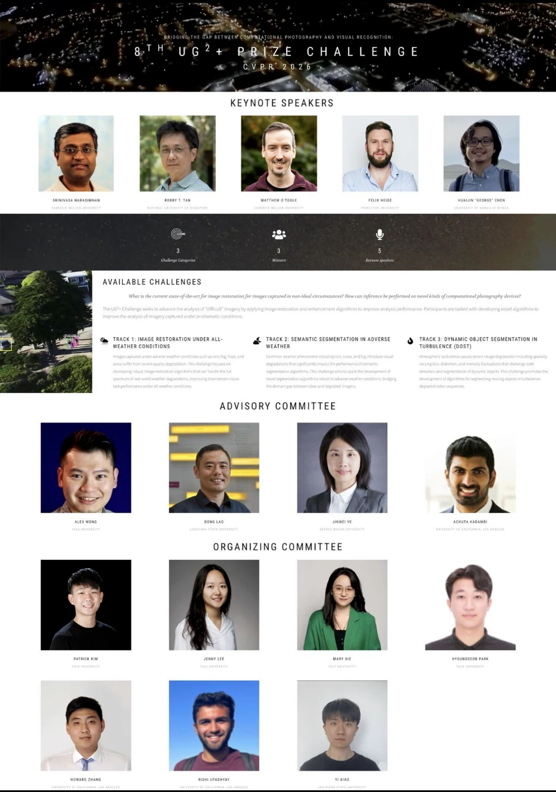
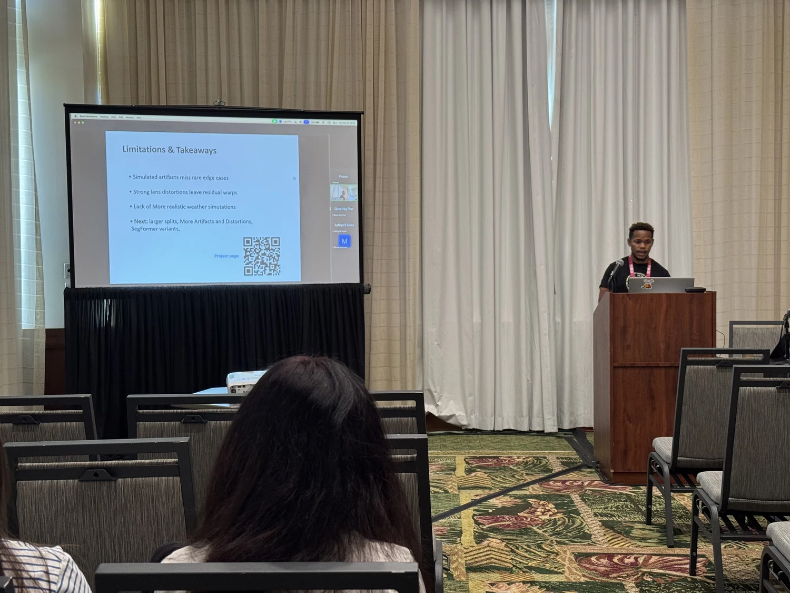

# News

## 2026-11-12 | UH Mānoa researchers present work on robot perception and learning at CoRL {#2026-11-12-cirp-and-uh-manoa-at-corl-in-austin}
The Conference on Robot Learning (CoRL) in Austin selected [3PTv2](https://openreview.net/forum?id=WNZ4Dr57JS), the successor to the [3D-Object Perception Transformer (3PT)](../research/3pt/), for a main-conference poster. CIRP doctoral student [Agastya Kalra](../people/#agastya-kalra) and co-authors, including [Huaijin Chen](../people/#huaijin-chen), developed the method to estimate the poses of previously unseen objects for robotic manipulation.

CoRL also selected [Telescopes are Optomechanical Robots](https://openreview.net/forum?id=RS2INStAhX) by UH Mānoa researcher Justin Fletcher for a main-conference poster. At the [UMI Arena workshop](https://umi-arena.airoa.io/accepted), Yosub Shin, Yuan Liu, and Igor Molybog presented a poster on tracking gloves with a head-mounted camera (P09) and demonstrated their [YAM-UMI device](https://github.com/YosubShin/yam-umi) (D10).
---

## 2026-10-01 | Riki MacMillan receives the Bubba Cook Award for fish measurement research {#2026-10-01-riki-macmillan-safet-2026}
CIRP graduate researcher [Riki MacMillan](../people/#riki-macmillan) received the Bubba Cook Award for Emerging Technology at the 2026 Seafood and Fisheries Emerging Technologies (SAFET) Conference in Cebu, Philippines. His September 9 talk, “Scalable Metric Measurement of Marine Life with Low-Cost Commodity Hardware,” described how smartphone cameras can measure marine life. [Huaijin Chen](../people/#huaijin-chen) and UH Mānoa colleague Erik Franklin also participated in the emerging technologies panel.

[SAFET award announcement](https://www.safet.fish/bubba-cook-award-for-emerging-technology-2026/) · [Panel recording](https://www.youtube.com/watch?v=AjQOYXbQYXo) · [Huaijin Chen’s conference recap](https://www.linkedin.com/posts/huaijinchen_safet2026-marineconservation-fisheriesscience-activity-7515553296754069504-KUXt)
---

## 2026-07 | USDA awards $154,517 for plant pathogen risk assessment with CIRP’s Huaijin Chen as Co-PI {#2026-07-usda-aphis-supports-plant-pathogen-risk-assessment}
CIRP Lab director [Huaijin Chen](../people/#huaijin-chen) serves as Co-PI on the project funded by USDA’s Animal and Plant Health Inspection Service. The team is developing a machine learning tool to assess risks posed by plant pathogens.
---

## 2026-06-04 | Huaijin Chen delivers computational imaging keynote at CVPR {#2026-06-04-huaijin-chen-gives-a-keynote-at-the-cvpr-2026-ug2-workshop}
[Huaijin Chen](../people/#huaijin-chen) gave the keynote “Do AI Agents Understand Computational Imaging?” at the [8th UG2+ Workshop and Challenge](https://cvpr2026ug2challenge.github.io/program24.html) during CVPR 2026 in Denver.

---

## 2026-06 | Minderoo Foundation awards $153,311 for CIRP-led research on 3D fish measurement {#2026-06-minderoo-foundation-supports-ai-based-fish-measurement}
CIRP Lab director [Huaijin Chen](../people/#huaijin-chen) leads the Minderoo Foundation project. His team is developing an app that reconstructs fish in 3D and estimates their size to help researchers monitor fisheries and ecosystems.
---

## 2026-03-18 | Google awards CIRP Lab $50,000 for 3D vision research in robotics {#2026-03-18-cirp-lab-receiving-a-50k-gift-from-google-for-research-in-3d-vision-for-robotics}
A $50,000 research gift from Google supports sensor development at CIRP Lab. The team will study how robots can use 3D vision to interpret scenes, manipulate objects, and operate autonomously.
---

## 2026-03-06 | CVPR accepts 3PT paper on object pose estimation {#2026-03-06-one-paper-accepted-at-cvpr-2026}
CVPR 2026 accepted “3D-Object Perception Transformer (3PT),” led by doctoral student [Agastya Kalra](../people/#agastya-kalra). The method detects and segments objects and estimates their position and orientation for tasks such as bin picking and precise insertion. It won seven of the eleven tracks in the 2025 BOP Challenge.
---

## 2026-03-06 | Christian Moore to join GM Cruise for a summer internship {#2026-03-06-phd-student-christian-moore-to-join-gm-cruise-for-summer-internship}
CIRP doctoral student [Christian Moore](../people/#christian-moore) will join the GM Cruise autonomous driving team for summer 2026. His research at CIRP focuses on robotic perception.
---

## 2026-03-06 | Ethan Chung and Norman Luo co-author preprint on imaging through turbulence {#2026-03-06-new-paper-on-imaging-through-turbulence-on-arxiv}
Master’s student [Ethan Chung](../people/#ethan-chung) and doctoral student [Norman Luo](../people/#man-luo) are the second and third authors, respectively, of a [preprint](https://arxiv.org/abs/2603.02048) on reconstructing distant scenes from images distorted by atmospheric turbulence.
---

## 2026-01-14 | NVIDIA Academic Grant supports farm robotics in Hawaiʻi {#2026-01-14-nvidia-academic-grant-awarded-thanks-nvidia}
An NVIDIA Academic Grant provides two RTX PRO 6000 Blackwell GPUs for training farm robotics models and four Jetson AGX Orin computers for running them in the field. We thank NVIDIA for supporting CIRP’s Farm Robotics Challenge projects on [pineapple mapping](../research/frc2025/) and [palm health](../research/frc2026/).

[Read the full story on UH News](https://www.hawaii.edu/news/2026/01/14/nvidia-awards-next-gen-tech/).
---

## 2025-10-15 | CIRP researchers present two workshop papers and an invited talk at ICCV {#2025-10-15-cirp-lab-iccv-2025-two-workshop-papers-invited-talk-and-local-chair-role}
At ICCV 2025 in Honolulu, CIRP researchers contributed two workshop papers and an invited talk. [Huaijin Chen](../people/#huaijin-chen) served as local chair.

- Doctoral student [Moseli Mots'oehli](../people/#moseli-mots-oehli) presented “Simulating Refractive Distortions and Weather-Induced Artifacts for Resource-Constrained Autonomous Perception” at the [CV4DC Workshop](https://cv4dc.github.io/).
- Doctoral student [Yang Qian](../people/#yang-qian) presented “Hashtag2Action: Data Engineering and Self-Supervised Pre-Training for Action Recognition in Short-Form Videos” at the [SVU Workshop](https://short-form-video-understanding.github.io/).
- [Agastya Kalra](../people/#agastya-kalra) gave an invited talk at the [BOP Workshop](https://cmp.felk.cvut.cz/sixd/workshop_2025/#bop).

### After-ICCV gathering at UH Mānoa

The October 24, 2025, gathering included research presentations and a campus tour.

[Event program (PDF)](../images/events/iccv-2025-uh-manoa-program.pdf)

---

## 2025-09-16 | NSF awards $300,000 for research on ultrafast X-ray diffraction {#2025-09-16-received-a-300k-nsf-grant-to-study-physics-informed-vlm-for-ultrafast-x-ray-diffraction-at-the-slac-national-lab-of-stanford-university}
[Huaijin Chen](../people/#huaijin-chen) received an [NSF EPSCoR Research Fellows Award (#2531897)](https://www.nsf.gov/awardsearch/showAward?AWD_ID=2531897) to study ultrafast X-ray diffraction with researchers at SLAC National Accelerator Laboratory. The collaboration uses physics-informed AI to interpret diffraction measurements.
---

## 2025-07-31 | Hawaiʻi Community Foundation funds research on cognitive screening {#2025-07-31-received-60k-hawaii-community-foundation-grant-for-computer-vision-based-early-screening-of-mild-cognitive-decline-and-alzheimer-s}
A [$59,152 grant from the Hawaiʻi Community Foundation](https://www.hawaiicommunityfoundation.org/) supports CIRP research on computer vision and AI methods for early screening of mild cognitive decline and Alzheimer’s disease.
---

## 2025-07-20 | PolarTact3D earns third-place paper award at RSS workshop {#2025-07-20-lab-undergraduates-win-3rd-place-best-paper-award-and-250-at-rss-2025-workshop}
CIRP undergraduates [Kai Garcia](../people/#kai-garcia) and [Mairi Yoshioka](../people/#mairi-yoshioka) received the third-place Best Paper Award and a $250 prize for PolarTact3D at the RSS 2025 Workshop on Navigating Contact Dynamics in Robotics. Their tactile sensor uses polarization imaging to capture the shape and color of a contact surface in a single shot.

[PolarTact3D project website](https://polartact3d.github.io/)
---

## 2025-06-25 | CIRP, OpenCV, and Intrinsic co-host the CVPR Bin-Picking Challenge {#2025-06-25-cirp-lab-co-hosting-the-cvpr-2025-bin-picking-workshop-and-competition-with-opencv-and-intrinsic}
CIRP co-hosted the CVPR 2025 Bin-Picking Workshop and Competition with OpenCV and Intrinsic. More than 450 teams worldwide competed to transfer perception methods from simulation to physical robots. The organizers awarded $60,000 in prizes. [Agastya Kalra](../people/#agastya-kalra) was a lead workshop organizer, and [Huaijin Chen](../people/#huaijin-chen) and [Yang Qian](../people/#yang-qian) served on the organizing team.

[Bin-Picking Challenge](https://bpc.opencv.org/) · [Challenge code](https://github.com/opencv/bpc)
---

## 2025-06-15 | Huaijin Chen speaks on visual sensing for robotics at Colorado School of Mines {#2025-06-15-invited-talk-at-colorado-school-of-mines-visual-sensing-for-real-world-robotics}
In an invited talk at Colorado School of Mines, [Huaijin Chen](../people/#huaijin-chen) discussed how robots use visual sensing on farms and factory floors. Examples included multimodal imaging, the CVPR 2025 Bin-Picking Workshop, the Farm Robotics Challenge, and the PolarTact3D tactile sensor.
---

## 2025-05-13 | Team ʻĀina wins $10,000 at the Farm Robotics Challenge {#2025-05-13-congrats-to-my-students-for-winning-the-10-000-grand-prize-at-the-2025-farm-robotics-challenge}
Team ʻĀina received the Excellence in Productivity (Air) award at the [2025 Farm Robotics Challenge](https://www.hawaii.edu/news/2025/05/13/farm-robotics-challenge-2025-winner/). The undergraduate team worked with Dole Plantation to develop a [drone and ground robot system](../research/frc2025/) that counts pineapples and estimates their size in the field.

[Christian Komo](../people/#christian-komo) led the team with faculty adviser [Huaijin Chen](../people/#huaijin-chen). Team members included [Kai Garcia](../people/#kai-garcia), [Mikhail Shkaralevich](../people/#mikhail-shkaralevich), [Tyler Mak](../people/#tyler-mak), [Rona Lei Duldulao](../people/#rona-lei-duldulao), [Lucas Horsman](../people/#lucas-horsman), [Zadon Padello](../people/#zadon-padello), [Wilson Huynh](../people/#wilson-huynh), and [Erik Bendickson](../people/#erik-bendickson).
---

## 2024-08-01 | Huaijin Chen founds CIRP Lab at UH Mānoa {#2024-08-01-joining-uhm}
[Huaijin Chen](../people/#huaijin-chen) joined the Department of Information and Computer Sciences at the University of Hawaiʻi at Mānoa as an assistant professor and founded the Computational Imaging and Robotic Perception Lab.
---
