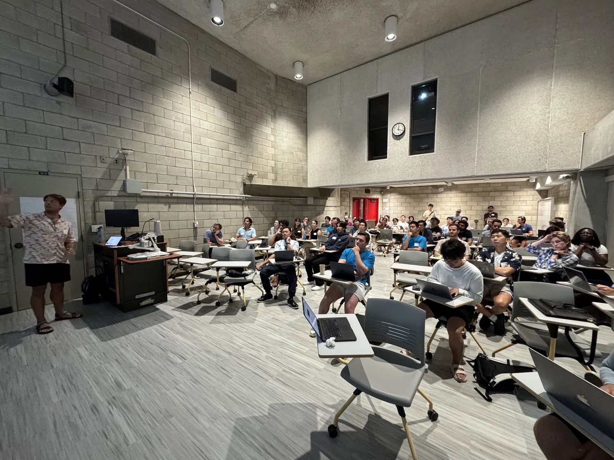
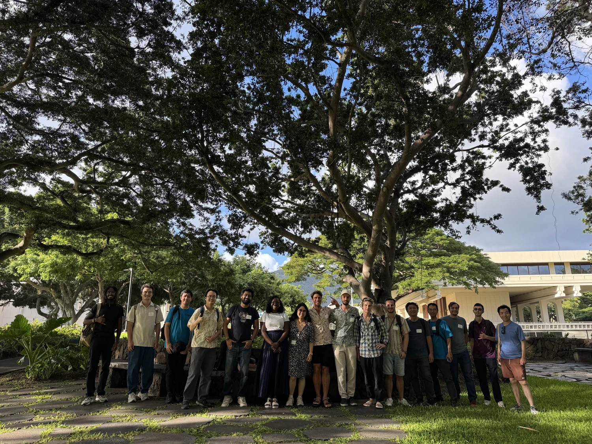
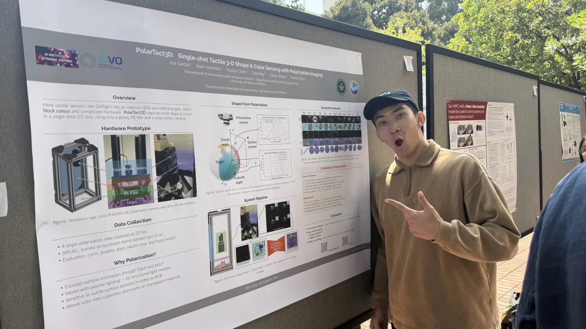
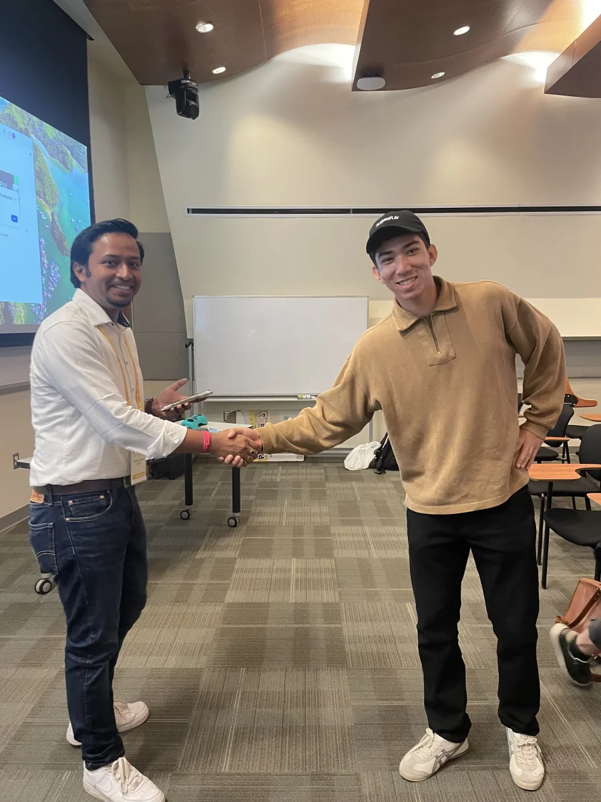

# News

## 2026-11-12 | CIRP and UH Mānoa at CoRL in Austin
[3PTv2](https://openreview.net/forum?id=WNZ4Dr57JS), a paper by CIRP PhD student Agastya Kalra and his colleagues, was selected for a main-conference poster at the Conference on Robot Learning (CoRL). The paper studies zero-shot 6D object pose estimation for robotic manipulation. Huaijin Chen co-authored the work.

Two other UH Mānoa contributions appeared at the conference. Justin Fletcher’s [Telescopes are Optomechanical Robots](https://openreview.net/forum?id=RS2INStAhX) was also accepted as a main-conference poster. At the [UMI Arena workshop](https://umi-arena.airoa.io/accepted), Yosub Shin, Yuan Liu, and Igor Molybog presented a poster on head-camera glove tracking (P09) and a hands-on exhibit of the [YAM-UMI](https://github.com/YosubShin/yam-umi) device (D10).
---

## 2026-10-01 | Riki MacMillan receives the Bubba Cook Award at SAFET 2026 {#2026-10-01-riki-macmillan-safet-2026}
CIRP graduate researcher Riki MacMillan received the **Bubba Cook Award for Emerging Technology** at the 2026 Seafood and Fisheries Emerging Technologies (SAFET) Conference in Cebu, Philippines. In his September 9 talk, *Scalable Metric Measurement of Marine Life with Low-Cost Commodity Hardware*, he presented work on measuring marine life with affordable smartphone cameras. Huaijin Chen and UH Mānoa colleague Erik Franklin also joined the panel on emerging technologies.

[SAFET award announcement](https://www.safet.fish/bubba-cook-award-for-emerging-technology-2026/) · [Panel recording](https://www.youtube.com/watch?v=AjQOYXbQYXo) · [Huaijin Chen’s conference recap](https://www.linkedin.com/posts/huaijinchen_safet2026-marineconservation-fisheriesscience-activity-7515553296754069504-KUXt)
---

## 2026-07 | Thank you to USDA for supporting plant pathogen risk assessment ($154,517) {#2026-07-usda-aphis-supports-plant-pathogen-risk-assessment}
Huaijin Chen is co-PI on a $154,517 USDA APHIS project to develop a machine learning decision-support tool for phytopathogen risk assessments.
---

## 2026-06-04 | Huaijin Chen gives a keynote at the CVPR 2026 UG2+ Workshop
Huaijin Chen presented “Do AI Agents Understand Computational Imaging?” at the [8th UG2+ Workshop and Challenge](https://cvpr2026ug2challenge.github.io/program24.html) in Denver.

---

## 2026-06 | Thank you to the Minderoo Foundation for supporting AI-based fish measurement ($153,311) {#2026-06-minderoo-foundation-supports-ai-based-fish-measurement}
The Minderoo Foundation awarded $153,311 for an app that measures fish and reconstructs them in 3D for fisheries and ecosystem monitoring. Huaijin Chen leads the project.
---

## 2026-03-18 | CIRP Lab receives a $50,000 gift from Google for 3D vision research in robotics {#2026-03-18-cirp-lab-receiving-a-50k-gift-from-google-for-research-in-3d-vision-for-robotics}
CIRP Lab has received a **2026 research gift from Google** to support our work on **3D vision for robotics**.
This support will help advance our research on visual perception for robots, including methods for **novel sensors**, **3D scene understanding**, **robotic manipulation**, and **real-world autonomy**.

We are grateful to Google for supporting academic research and collaboration with the CIRP Lab.
---

## 2026-03-06 | One Paper Accepted at CVPR 2026
Congratulations to lab member and PhD student **Agastya Kalra** on the acceptance of his first-author paper on **6-DoF object pose estimation** at **CVPR 2026**.
The paper introduces a unified framework for detecting and segmenting objects and estimating their 6-DoF poses.
This work demonstrates strong performance on **BOP benchmarks** and targets real-world robotics applications such as bin picking and precise insertion.

Great work by Agastya and his collaborators.
---

## 2026-03-06 | PhD Student Christian Moore to Join GM Cruise for Summer Internship
Congratulations to lab member and PhD student **Christian Moore** on his **summer 2026 internship** with the **GM Cruise** autonomous driving team.
Christian has been working on perception and robotics systems in the CIRP Lab, and we are excited to see him bring these skills to real-world autonomous driving systems.

We look forward to seeing what he builds this summer and hearing what he learns.
---

## 2026-03-06 | New Paper on Imaging Through Turbulence on arXiv
A new paper on computational imaging through turbulence is now [available on arXiv](https://arxiv.org/abs/2603.02048).
MS student **Ethan Chung** and PhD student **Norman Luo** are the paper’s second and third authors, respectively.
The paper studies imaging and reconstruction methods for scenes degraded by atmospheric turbulence, an important challenge for long-range vision and sensing systems.
---

## 2026-01-14 | NVIDIA Academic Grant Awarded! Thanks, NVIDIA!
CIRP Lab has received an **NVIDIA Academic Grant** to support our agricultural robotics research project.
The award provides high-performance computing hardware to support the development of AI-enabled farm robots, including **two RTX PRO 6000 Blackwell GPUs** for training large AI models and **four Jetson AGX Orin** edge computers that will serve as onboard computing systems for field robots.
The project focuses on combining robotics, computer vision, and edge AI to build practical tools that can operate directly in farm environments, helping address labor challenges and improve agricultural productivity in Hawai'i and beyond.

[Read the full story on UH News](https://www.hawaii.edu/news/2026/01/14/nvidia-awards-next-gen-tech/).
---

## 2025-10-15 | CIRP Lab at ICCV 2025 {#2025-10-15-cirp-lab-iccv-2025-two-workshop-papers-invited-talk-and-local-chair-role}
**CIRP Lab** contributed to **ICCV 2025** with **two workshop papers**, **one invited talk**, and a **local chair role**.

- Paper 1 by PhD student **Moseli Mots'oehli**: *Simulating Refractive Distortions and Weather-Induced Artifacts for Resource-Constrained Autonomous Perception* at the [CV4DC Workshop](https://cv4dc.github.io/).
- Paper 2 by PhD student **Yang Qian**: *Hashtag2Action: Data Engineering and Self-Supervised Pre-Training for Action Recognition in Short-Form Videos* at the [SVU Workshop](https://short-form-video-understanding.github.io/).
- Invited talk by **Agastya Kalra** at the [BOP Workshop](https://cmp.felk.cvut.cz/sixd/workshop_2025/#bop).
- **Huaijin Chen** served as **Local Chair** for ICCV 2025 in Honolulu.

### After-ICCV gathering at UH Mānoa

The October 24, 2025, gathering included research presentations and a campus tour.

[Event program (PDF)](../images/events/iccv-2025-uh-manoa-program.pdf)

---

## 2025-09-16 | CIRP Lab receives a $300,000 NSF grant for ultrafast X-ray diffraction research {#2025-09-16-received-a-300k-nsf-grant-to-study-physics-informed-vlm-for-ultrafast-x-ray-diffraction-at-the-slac-national-lab-of-stanford-university}
Huaijin Chen received an [NSF EPSCoR Research Fellows Award (#2531897)](https://www.nsf.gov/awardsearch/showAward?AWD_ID=2531897) as principal investigator. The award supports a collaboration with SLAC National Accelerator Laboratory on physics-informed AI for ultrafast X-ray diffraction and AI-driven scientific discovery.

**Thank you, NSF and SLAC!**
---

## 2025-07-31 | Hawaiʻi Community Foundation supports early screening research {#2025-07-31-received-60k-hawaii-community-foundation-grant-for-computer-vision-based-early-screening-of-mild-cognitive-decline-and-alzheimer-s}
A [$59,152 grant from the Hawaiʻi Community Foundation](https://www.hawaiicommunityfoundation.org/) supports the development of computer vision and AI methods for early screening of mild cognitive decline and Alzheimer’s disease.

**Thank you, HCF!**
---

## 2025-07-20 | Lab undergraduates win 3rd Place Best Paper Award (and $250) at RSS 2025 Workshop
Congratulations to **Kai Garcia** and **Mairi Yoshioka**, whose *PolarTact3D* paper won the **3rd Place Best Paper Award** at the **RSS 2025 Workshop on Navigating Contact Dynamics in Robotics**.

Learn more at [polartact3d.github.io](https://polartact3d.github.io/).
---

## 2025-06-25 | CIRP Lab co-hosts the CVPR 2025 Bin-Picking Workshop and Competition with OpenCV and Intrinsic {#2025-06-25-cirp-lab-co-hosting-the-cvpr-2025-bin-picking-workshop-and-competition-with-opencv-and-intrinsic}
The **CIRP Lab** co-hosted the **CVPR 2025 Bin-Picking Workshop and Competition** with **OpenCV** and **Intrinsic**.

- More than **450 teams** participated worldwide.
- The event advanced industrial robotic perception through simulation-to-reality innovation.
- A total of **$60,000 in prizes** was awarded.

Learn more at [bpc.opencv.org](https://bpc.opencv.org/) and [github.com/opencv/bpc](https://github.com/opencv/bpc).
---

## 2025-06-15 | Invited Talk at Colorado School of Mines — Visual Sensing for Real-World Robotics
Huaijin Chen gave an invited talk at the **Colorado School of Mines** on how visual sensing can improve productivity on farms and factory floors. He highlighted work on multimodal imaging, the **CVPR 2025 Bin-Picking Workshop**, the **Farm Robotics Challenge**, and **PolarTact3D**.
---

## 2025-05-13 | Team ʻĀina wins a $10,000 award at the 2025 Farm Robotics Challenge {#2025-05-13-congrats-to-my-students-for-winning-the-10-000-grand-prize-at-the-2025-farm-robotics-challenge}
Congratulations to the undergraduate team for winning the **Excellence in Productivity (Air)** award at the [2025 Farm Robotics Challenge](https://www.hawaii.edu/news/2025/05/13/farm-robotics-challenge-2025-winner/).

Their AI-powered robot and drone system, developed with **Dole Plantation**, automatically counts and sizes pineapples in the field.
---

## 2024-08-01 | Huaijin Chen joins UH Mānoa and starts CIRP Lab {#2024-08-01-joining-uhm}
Huaijin Chen joined the **University of Hawaiʻi at Mānoa** as an assistant professor in the Department of Information and Computer Sciences and founded the CIRP Lab.
---
